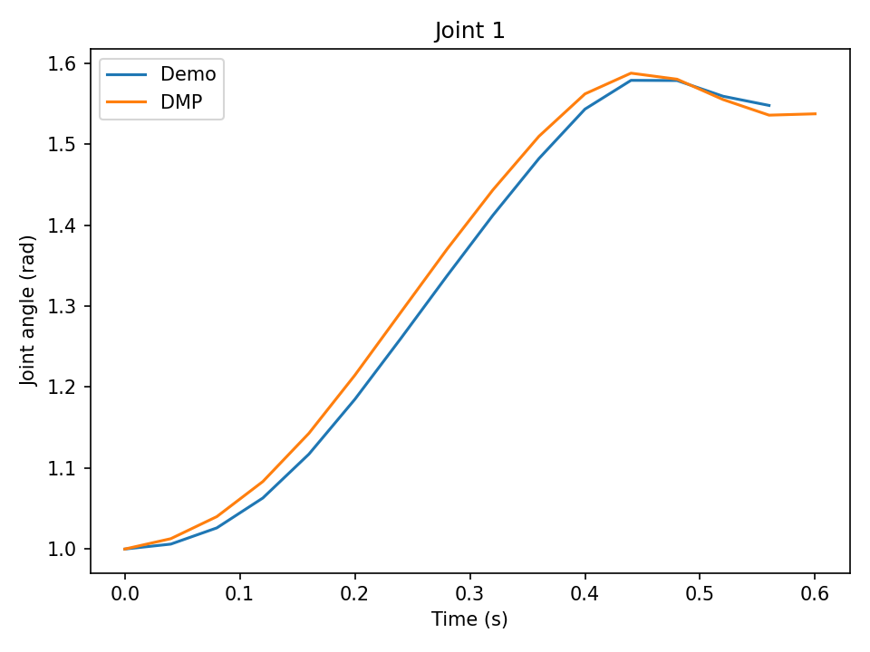

> **Interested in the DDPM math and a short demo?** Explore my companion project, [DDPM From Scratch](https://github.com/chaohsuchen/DDPM-From-Scratch), for the mathematical derivation and a short demo.
>
> [](https://github.com/chaohsuchen/DDPM-From-Scratch)
>
> *The animation links to the companion DDPM project; it is not a robot rollout from this repository.*

# Watch, Plan, Act
### Diffusion Policies for Robot Imitation Learning

How can a robot learn a precise manipulation task by watching human demonstrations? This project trains a simulated Franka Panda to place a square nut onto a peg, using two camera views and its own gripper state. It compares a policy that predicts one action directly with diffusion policies that generate a short plan of actions.

Developed from **CSC2626: Imitation Learning for Robotics** coursework. The project builds on course-provided networks, data utilities, and simulator integration; the implemented components include DDPM noising, both training objectives, reverse sampling, and action chunk execution. The portfolio analysis adds an auditable comparison and a sigmoid noise-schedule experiment. See [attribution](docs/ATTRIBUTION.md).

**Start here:** [Conversational project report (PDF)](output/pdf/robot_imitation_report.pdf) · [Architecture and results](docs/PROJECT_REPORT.md) · [Run the experiments](docs/REPRODUCING.md)

## The project in 30 seconds

- **Problem:** turn human demonstrations into a policy for visual robot manipulation.
- **Data:** 200 Robomimic square-task demonstrations, containing 30,154 observation/action pairs.
- **Methods:** single-step behavior cloning (BC), diffusion with noise prediction, and diffusion with clean-action prediction.
- **Result:** at 100,000 updates, success was **20% for BC, 48% for diffusion ε, and 52% for diffusion x₀**, with 25 evaluation episodes per checkpoint.
- **Engineering:** PyTorch policies, image encoders, action normalization, MuJoCo evaluation, checkpoint loading, CSV logging, GPU/Slurm scripts, and reverse-diffusion visualizations.

These are simulation results from one recorded training run per method. The comparison includes both diffusion and action chunking; it does not isolate the effect of diffusion alone.

## From observation to action


Both methods see the same current observation: an external camera image, a wrist camera image, end-effector position and orientation, and gripper position. ResNet18 image features and robot-state features are combined into a 256-dimensional condition vector for a shared DiT1d architecture.

**BC:** predict one 7-dimensional action, execute it, and observe again. Training minimizes squared error against the demonstrator's action. The DiT input action and timestep are fixed to zero; observation conditioning still drives the prediction.

**Diffusion:** start with a noisy 10-action sequence and refine it over 50 denoising steps, conditioned on the observation. Execute the first eight actions, observe again, and generate a new plan. The two variants learn to predict either the added noise (ε) or the original clean sequence (x₀). Both are imitation learning methods; “BC” here names the direct-regression baseline.

The action contains three position increments, three axis-angle rotation increments, and one gripper command. This is end-effector control, not joint-angle prediction.

## What happened?


| Policy | Final success at 100k updates | Best observed checkpoint |
|---|---:|---:|
| BC, single action | 20% (5/25) | 32% at 40k |
| Diffusion ε, cosine schedule | 48% (12/25) | 48% at 100k |
| Diffusion x₀, cosine schedule | 52% (13/25) | 88% at 80k |
| Bonus: diffusion ε, sigmoid schedule | 60% (15/25) | 76% at 70k |

**What I learned:** the diffusion-plus-chunking setup outperformed the single-step baseline at the final checkpoint. Clean-action prediction improved earlier in much of this run, but its peak did not persist. The sigmoid schedule improved final ε-prediction performance in this run. More training did not produce a steadily better policy.

**How far do those claims go?** Each evaluation has only 25 episodes, so one outcome moves the score by four percentage points. The final x₀-versus-ε gap is just one success. Multiple training seeds, larger evaluations, and a chunked BC baseline would be needed for stronger conclusions. Best-checkpoint scores are descriptive and were not confirmed on a separate selection set. We compare success rates because BC and diffusion accumulate raw rewards differently.

The figure and table are generated from the [checked-in evaluation CSVs](Q3/results). See the [full analysis](docs/PROJECT_REPORT.md) for experimental controls and limitations.

## Explore the implementation

| File | What it demonstrates |
|---|---|
| [DDPM](Q3/ddpm.py) | Forward noising, ε/x₀ objectives, reverse diffusion, EMA weights |
| [Diffusion policy](Q3/diffusion_policy.py) | Observation-conditioned action generation and chunk execution |
| [BC baseline](Q3/bc.py) | Supervised action regression with the same backbone architecture |
| [Dataset](Q3/utils/dataset.py) | HDF5 demonstrations, normalization, sequence sampling |
| [Networks](Q3/networks) | Multi-view visual conditioning and a 1D diffusion transformer |
| [Smoke check](smoke_q3.py) | Short training, checkpoint reload, inference, and output checks |
| [Analysis script](scripts/analyze_results.py) | Rebuild figures and summary metrics from saved evaluations |
| [DMP extension](Q2) | Earlier course work on trajectory learning and closed-loop UR10 ball catching |

## A second robotics example: learning a ball-catching motion

The course-derived [DMP exercise](Q2) learns demonstrated joint trajectories and uses a closed-loop controller to drive a simulated UR10. Its [recorded robot rollout](Q2/results/ballcatch.mp4) provides a direct look at task execution, alongside the diffusion action-vector visualizations above.

| Recorded result | Value |
|---|---:|
| Ball-catching success rate | 40% |
| Average episode reward | -17.76 |
| Best trajectory reconstruction RMSE | 0.06804 radians |
| Best tested DMP configuration | 45 basis functions, gain 25 |

The [evaluation CSV](Q2/results/ballcatch_metrics.csv) stores aggregate scores; the evaluation entry point uses 20 episodes. The [tuning CSV](Q2/results/tuning.csv) covers 20 configurations and measures fit on the demonstrated trajectories, rather than held-out generalization. This is a separate task and is not a baseline for square-nut assembly.

[](Q2/results/README.md)

See the [results guide](Q2/results/README.md) for all six joint reconstruction plots, tuning metrics, and the rollout video.

## Reproduce and inspect

See [the setup and run guide](docs/REPRODUCING.md) for dependencies, dataset download, full training commands, and Slurm execution. A short local execution check is available:

```bash
source .venv/bin/activate
python smoke_q3.py                 # automatically selects CUDA, MPS, or CPU
python scripts/analyze_results.py  # regenerates the analysis without training
```

Dataset files and neural-network checkpoints are excluded from Git. Evaluation/training CSVs and sampling videos are included. The [ε sampling video](Q3/results/diffusion_policy_eps/reverse_diffusion_eps.mp4) and [x₀ sampling video](Q3/results/diffusion_policy_x0/reverse_diffusion_x0.mp4) show generated action vectors during denoising, not a robot completing the task.

## Credit and scope

This is a course-derived implementation and analysis, not a claim to have invented Diffusion Policy, DiT, or Robomimic. All reported robot experiments use simulation; no physical hardware deployment is claimed. The original assignment handout and submission package are excluded from the public project. Upstream methods and starter-code provenance are listed in [acknowledgments](docs/ATTRIBUTION.md).
