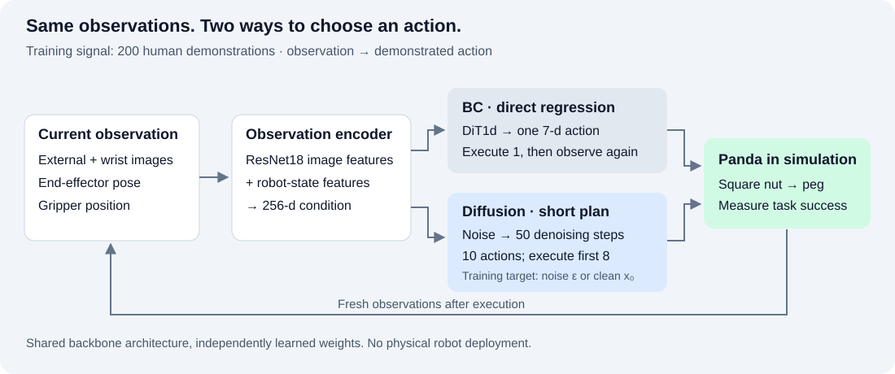
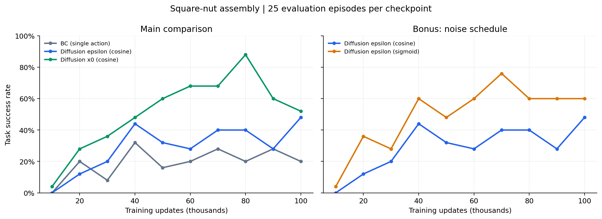

# Watch, Plan, Act: a guided project walkthrough

## What are we trying to solve?

Imagine asking a robot to pick up a square nut and fit it onto a peg. That sounds simple until the robot has to infer the nut's location from images, orient its gripper, grasp the object, and align it precisely. Instead of writing a separate rule for every situation, this project asks: can we learn those action choices from human demonstrations?

The experiments use a simulated Franka Panda in Robomimic's NutAssemblySquare environment. This project originated in CSC2626: Imitation Learning for Robotics and extends the course work with a portfolio-oriented analysis and a noise-schedule comparison. The network and simulator scaffolding were provided; the DDPM operations and action chunking are the implemented algorithm components. This is simulation experience, not physical robot deployment.

## What exactly does the robot learn from?

The local `Q3/data/robomimic/datasets/square/ph/image.hdf5` file contains 200 proficient-human demonstrations and 30,154 time steps. A time step pairs the current observation with a human action. The policy uses two 84-by-84 RGB images (external and wrist cameras), end-effector position (3 values), quaternion orientation (4), and gripper position (2). Other stored observations, including object state, are not selected as policy inputs.

Each target action has seven values: three position increments, three axis-angle rotation increments, and a gripper command. Inputs and actions are normalized using the dataset; predicted actions are converted back before execution. The current loader consumes all 200 demonstrations, including those listed in the dataset's built-in validation mask. There is no held-out demonstration validation claim here. Policy quality is measured by running the learned controller in the simulator.

## How does the architecture fit together?

First, the observation encoder turns each camera view into ResNet18 image features and combines them with the robot's own state. A multilayer perceptron produces a 256-dimensional condition vector. Both policies use that condition with the same DiT1d backbone architecture (width 320, two blocks, ten attention heads), but learn their own weights.

For BC, the question is: “Given this view, what action did the human take?” The model outputs one action and minimizes its mean squared error against the demonstration. Although the code reuses a diffusion-transformer interface, its action input and timestep are constants set to zero. The real observation still enters through conditioning. There is no noising or denoising process. It is behavior cloning because it learns a policy by supervised imitation of demonstrated actions.

For diffusion, the question becomes: “Given this view, what short action sequence could work?” During training, Gaussian noise is added to a demonstrated 10-action sequence. One variant predicts the noise (epsilon); the other predicts the original clean sequence (x0). At execution, both start from random noise and apply 50 reverse-diffusion steps to generate a sequence. The controller executes the first eight actions before observing and replanning. Denoising iterations and physical environment steps are different loops.

A benefit this design aims for is a coherent short plan rather than unrelated single-action estimates. Diffusion can represent a conditional distribution over action sequences, whereas deterministic squared-error regression can average competing demonstrated actions. These are motivations for the design, not mechanisms proven by the success-rate measurements alone.

## What did we compare?

The main comparison has three policies: single-action BC, diffusion epsilon with a cosine noise schedule, and diffusion x0 with the same schedule. The bonus keeps epsilon prediction and changes the schedule to sigmoid. The scripts' standard configuration is 100,000 updates, batch size 64, learning rate 0.0001, seed 0, evaluation every 10,000 updates, 25 episodes per checkpoint, and a 500-step episode limit. The archived CSVs establish steps and scores, but do not embed a complete run configuration or software manifest; the listed hyperparameters come from the supplied run scripts and defaults.

BC versus diffusion changes two things at once: the learning/generation method and action chunking. Epsilon versus x0 more directly compares the training target. Cosine versus sigmoid compares the noise schedule within epsilon prediction. Equal update counts do not establish equal wall-clock cost or inference latency; neither was benchmarked for this report.

## What did we find?

| Method | Final success | Highest recorded success |
|---|---:|---:|
| BC | 20% (5/25) | 32% at 40k |
| Diffusion epsilon, cosine | 48% (12/25) | 48% at 100k |
| Diffusion x0, cosine | 52% (13/25) | 88% at 80k |
| Diffusion epsilon, sigmoid | 60% (15/25) | 76% at 70k |

The final diffusion-plus-chunking controllers completed the task more often than the single-action baseline. The x0 model was ahead of the cosine epsilon model at most intermediate checkpoints and reached the largest observed peak, but fell from 88% at 80k to 52% at 100k. That tells us the observed learning curve is not monotonic; it does not, by itself, diagnose overfitting or a specific failure mechanism.

The sigmoid experiment ended at 60%, versus 48% for cosine epsilon. That makes noise-schedule choice a useful follow-up in this setup, but it is one run rather than evidence of a universal improvement.

## What should we be careful about?

There is one recorded run per method, with no multi-seed uncertainty estimate. Each checkpoint evaluation contains 25 episodes, so one outcome changes the result by four percentage points. In particular, 52% versus 48% is only one extra success. A peak chosen from ten evaluations is an optimistic selection and needs independent confirmation. We have not reviewed task rollouts to categorize failure cases; the included sampling videos show denoising action vectors, not task execution or hardware validation.

Raw rewards are not directly comparable: BC sums step rewards, while diffusion sums the maximum reward within each executed chunk. The success flag is based on whether the episode accumulates positive sparse task reward, so this report uses success rate as the common measure. Fixed demonstrations provide the training signal; evaluation rewards do not train the policy.

## What robotics experience does this demonstrate?

The concrete work spans learning from demonstrations, visual observation processing, continuous end-effector control, DDPM training and sampling, receding-horizon action execution, simulation integration, checkpoint handling, GPU job execution, and interpreting noisy experimental results. The contribution is implementing and connecting those components within a provided course scaffold, then examining what the resulting evidence actually supports.

The next experiment I would run is chunked BC with the same horizon and execution interval as diffusion, repeated across multiple seeds and evaluated on a larger, separate episode set. I would also record task rollouts to distinguish failed grasping from failed alignment and benchmark policy latency. Those additions would help explain where the improvement comes from and what still prevents reliable operation.

## Evidence and provenance

Numbers are read from `Q3/results/{bc,diffusion_policy_eps,diffusion_policy_x0,diffusion_policy_eps_sigmoid}/eval_metrics.csv`. Run `python scripts/analyze_results.py` to regenerate summary metrics and plots. Dataset counts were inspected directly from the local HDF5 file. See [reproduction instructions](REPRODUCING.md) and [attribution](ATTRIBUTION.md) for setup and the boundary between starter code and implemented work.
